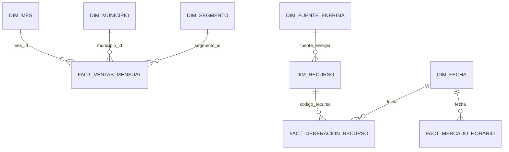

# Modelo dimensional – Observatorio de Energía

## 1. Objetivo

La capa Gold organiza la información energética en un modelo dimensional para facilitar consultas analíticas sobre ventas, mercado eléctrico y generación.

## 2. Arquitectura

El modelo utiliza un esquema dimensional tipo estrella, compuesto por tres tablas de hechos y seis dimensiones.

### Tablas de hechos

| Tabla | Grano | Medidas principales |
|---|---|---|
| fact_ventas_mensual | Mes, municipio, segmento y tipo de compra | energia_kwh, valor_cop, clientes |
| fact_mercado_horario | Fecha y hora | precio_bolsa, demanda_mwh |
| fact_generacion_recurso | Fecha, hora y recurso | generacion |

### Dimensiones

| Dimensión | Grano | Llave principal |
|---|---|---|
| dim_mes | Un mes | mes_id |
| dim_municipio | Un municipio | municipio_id |
| dim_segmento | Un segmento | segmento_id |
| dim_fecha | Un día | fecha_id |
| dim_recurso | Un recurso de generación | codigo_recurso |
| dim_fuente_energia | Una fuente energética | fuente_energia |

## 3. Diagrama del modelo

Las llaves primarias de las dimensiones se comprueban con pruebas `unique` y `not_null`. Las llaves foráneas se comprueban con `relationships`. Los granos compuestos de los hechos también tienen pruebas de unicidad y todos sus campos de llave tienen pruebas `not_null`. DuckDB no crea restricciones físicas de llave foránea para estos modelos; las pruebas hacen fallar el `dbt build` si se repiten llaves o falta una fila relacionada.

## 4. Descripción de las tablas de hechos

### fact_ventas_mensual

Registra las ventas de energía agrupadas por periodo mensual, municipio, segmento y tipo de compra. Permite analizar energía comercializada, valor económico y cantidad de clientes.
Su clave compuesta es mes, municipio, segmento y tipo de compra.

### fact_mercado_horario

Integra el precio de bolsa y la demanda real del sistema eléctrico mediante fecha y hora. Su información procede de XM.
Su clave compuesta es fecha y hora.

### fact_generacion_recurso

Registra la generación eléctrica por recurso, fecha y hora. Se relaciona con el catálogo de recursos de XM mediante codigo_recurso.
Su clave compuesta es fecha, hora y código de recurso.

## 5. Dimensiones descriptivas

- dim_mes: permite analizar las ventas por año, mes y trimestre.
- dim_municipio: identifica los municipios mediante código DIVIPOLA.
- dim_segmento: clasifica los segmentos de clientes.
- dim_fecha: contiene atributos temporales y la fase ENSO.
- dim_recurso: contiene el catálogo descriptivo de recursos de generación.
- dim_fuente_energia: identifica las fuentes energéticas registradas en XM.

## 6. Fuentes de información

- EnerAndes: ventas mensuales de energía.
- XM: precio de bolsa, demanda, generación y catálogo de recursos.
- NOAA: anomalía ONI y fase ENSO.

## 7. Validación

La ejecución de `dbt build` construyó 10 modelos y ejecutó 37 pruebas de calidad. Pasaron las 47 ejecuciones (10 modelos y 37 pruebas), sin errores ni advertencias. Las pruebas incluyen llaves primarias, relaciones y unicidad de las claves compuestas de los hechos.

## 8. Estado de implementación de las relaciones

| Relación | Tipo | Estado |
|---|---|---|
| fact_ventas_mensual.mes_id → dim_mes.mes_id | Clave foránea | Implementada y probada |
| fact_ventas_mensual.municipio_id → dim_municipio.municipio_id | Clave foránea | Implementada y probada |
| fact_ventas_mensual.segmento_id → dim_segmento.segmento_id | Clave foránea | Implementada y probada |
| fact_generacion_recurso.codigo_recurso → dim_recurso.codigo_recurso | Clave foránea | Implementada y probada |
| fact_mercado_horario.fecha → dim_fecha.fecha | Prueba de relación dbt | Implementada y probada |
| fact_generacion_recurso.fecha → dim_fecha.fecha | Prueba de relación dbt | Implementada y probada |
| dim_recurso.fuente_energia → dim_fuente_energia.fuente_energia | Prueba de relación dbt | Implementada y probada |

La dimensión de fecha reúne fechas de ventas, precio de bolsa, generación y ONI. Los recursos sin información de fuente energética reciben la categoría «No informado», incluida en `dim_fuente_energia`, para que la relación se pueda comprobar sin descartar registros.
